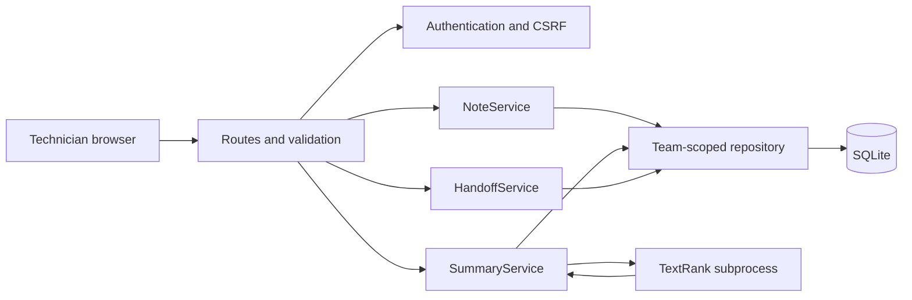

# Architecture and design decisions

One Flask application with cohesive modules, matching the Unit 3 modular-monolith plan. All three internal roles are performed by Jose for the solo project. There are no invented teammates, contributions, or external review events.

The summarizer receives only a permitted source snapshot as JSON through stdin. It receives no session or database connection. The parent controls a four-second wall-clock timeout and admits only one ranking process per application instance. `subprocess.run` kills and waits for the worker on timeout. Results are indices into the trusted snapshot, not generated operational facts.

`BEGIN IMMEDIATE` transactions group note insertion with revision changes, and group version/source checks with review/approval persistence. Summary ranking happens outside the write transaction so the worker does not hold the SQLite writer lock. A draft created while a new note is added can be stale immediately; review/approval rejects it using the recorded source revision.

Source notes and original extraction events are retained. Extraction item IDs, source-sentence IDs, and wording must match the generation event when saving a review. Technician additions have new IDs and no source-sentence claim. Approved summaries are immutable through the application API. Approval retries with the original version return the existing approval.

Sessions are random 256-bit opaque tokens; only token hashes are stored in SQLite. Passwords use Werkzeug's default salted scrypt hashing. Session rotation invalidates the old token after sign-in. CSRF tokens are checked on mutations, including sign-in. Responses prohibit framing and inline scripts. The browser uses `textContent` and DOM nodes for user content, never HTML interpolation.

Each resource query verifies the current user's team. Shared-team technicians can review each other's shift records, consistent with the design. This is not a multi-tenant production assurance claim. One user has one seeded team in this Alpha.

## Differences from the written design

- The UI recommends five selected sentences after synthetic validation; the API default remains three.
- An additive `GET /shifts/{id}/summaries` endpoint makes persisted drafts/approvals discoverable after reload.
- Hosted deployment is not implemented; `HANDOFF_HTTPS=1` enables secure cookies for future HTTPS hosting, but transport/proxy configuration still needs deployment work. Default execution binds only to loopback.
- The original Unit 4 workflow is preserved as tests.yml and extended to install web dependencies, run all 52 tests and the original demo, and gate coverage/security. Verify the hosted final branch separately.
- Source snapshot limits, heuristic sentence splitting, local storage, and the absence of production load testing are explicit Alpha limits.

## Persistence

`users`, `sessions`, and `login_attempts` support authentication. `shifts` has team sequence and source revision. `notes` has per-shift sequence, author, timestamp, and immutable text. `summaries.body` stores the full JSON snapshot and review state. `review_events` records initial extraction, saved review versions, and approval. SQL values are parameterized. No runtime database is shipped.

Test data and development logs contain fictional content. Production monitoring, migrations, restore testing, and multi-process admission control remain future work documented in the debt register.

## Compatibility with the recovered backend

The original Store and demo remain available for the original tests and CLI demonstration. New web services use an enriched schema with authenticated actor IDs, note authors/timestamps, pagination, and review events. They preserve the source/version/approval invariants but do not migrate the original Store database. Both paths share the original cosine sentence-graph ranking. Consolidating the Store compatibility layer and web repository is explicit future refactoring work.
